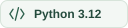
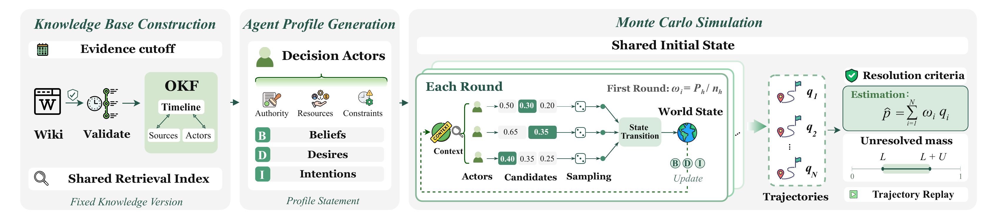
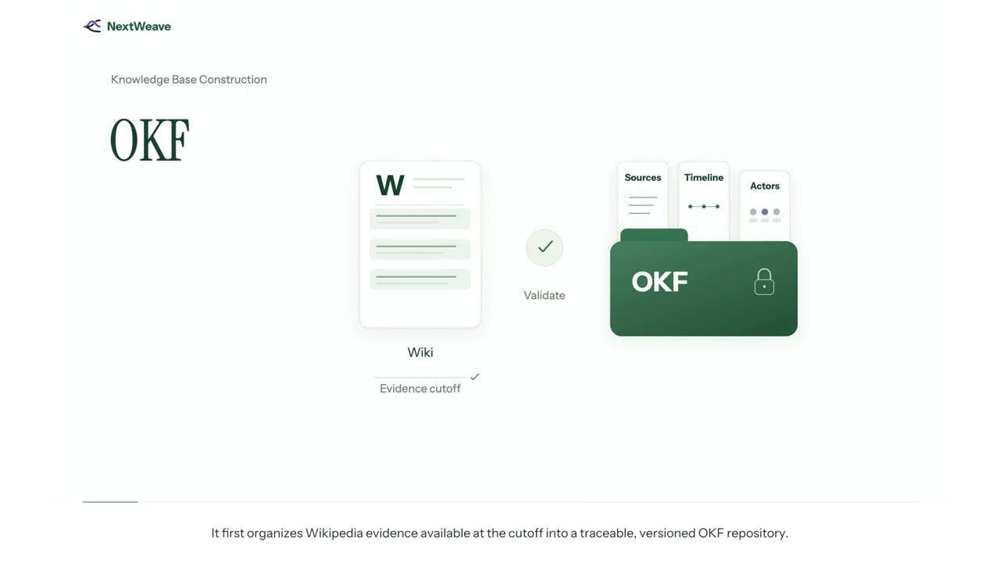

<h1 align="center">
  
  NextWeave
</h1>

<p align="center">
  <strong>A Monte Carlo-Driven Multi-Agent Simulation Platform for Event Forecasting</strong>
</p>

<p align="center">
  
  
  
</p>

<p align="center">
  <a href="#framework">Framework</a> ·
  <a href="#demo">Demo</a> ·
  <a href="#quick-start">Quick start</a> ·
  <a href="#configuration">Configuration</a> ·
  <a href="#usage">Usage</a> ·
  <a href="#market-evaluation">Market evaluation</a>
</p>

NextWeave is an end-to-end multi-agent simulation platform for probabilistic event forecasting. It explores how sequential decisions and interactions among real-world actors may shape alternative futures. Grounded in a traceable historical knowledge base and Belief-Desire-Intention (BDI)-based actor profiles, NextWeave performs Monte Carlo simulations through probabilistic action selection, joint environment resolution, and iterative state updates. It combines trajectory-conditional estimates using sampling weights to produce an overall forecast, while retaining unresolved probability mass. Trajectory replay allows users to inspect the decisions and consequences behind the forecast.

<a id="framework"></a>

## 🧭 Framework

[](docs/media/framework.pdf)

*Overview of the NextWeave framework. Select the figure to view the vector PDF.*

<a id="demo"></a>

## 🎬 Demo

[](docs/media/NextWeave_Demo.mp4)

Watch the website workflow and simulation method in the included demonstration.

<a id="quick-start"></a>

## 🚀 Quick start

### Requirements

- Python **3.12**
- Node.js **20 or later** and npm
- Network access for Wikipedia collection and the configured language-model provider
- A compatible model endpoint and API credentials for generation and simulation

### 1. Start the backend

From the project root:

```bash
cd backend
python3.12 -m venv .venv
source .venv/bin/activate
pip install -r requirements.txt
cp .env.example .env
python -m uvicorn app.main:app --host 127.0.0.1 --port 8000
```

On Windows, activate the environment with `.venv\Scripts\activate` instead. Backend defaults can be entered in `.env`, or supplied through the website settings.

### 2. Start the frontend

In a second terminal, from the project root:

```bash
npm ci
npm run build
npm start
```

Open **[http://localhost:3000](http://localhost:3000)**. The local frontend connects to **http://localhost:8000/api** by default.

For frontend development with automatic reload:

```bash
npm run dev
```

### 3. Configure a model

Open **Settings**, choose a provider, and enter its **Base URL**, **API Key**, and **Model**. Alternatively, select the backend-default option and configure `backend/.env`.

Use a provider that supports OpenAI-compatible chat completions and structured JSON output. Agent-assisted fallback operations also require a compatible provider setup. Credentials entered in the frontend are sent to the selected backend for provider authentication.

The backend health endpoint is **[http://localhost:8000/health](http://localhost:8000/health)**. Interactive API documentation is available at **[http://localhost:8000/docs](http://localhost:8000/docs)**.

## Configuration

Backend configuration is read from `backend/.env`. Request-level model settings override backend defaults.

| Variable | Purpose | Default |
| --- | --- | --- |
| `LLM_API_KEY` | Backend-default provider credential | Empty |
| `LLM_MODEL` | Backend-default model identifier | Empty |
| `LLM_BASE_URL` | Provider endpoint | `https://openrouter.ai/api/v1` |
| `LLM_TIMEOUT_SECONDS` | Model-request timeout | `120` |
| `AGENT_SDK_TIMEOUT_SECONDS` | Agent-assisted operation timeout | `120` |
| `AGENT_SDK_MAX_CONCURRENCY` | Concurrent SDK operations | `2` |
| `AGENT_SDK_MAX_TURNS` | SDK turn limit | `3` |
| `ACTOR_EXTRACTION_MAX_CONCURRENCY` | Actor extraction concurrency | `8` |
| `FRONTEND_ORIGINS` | Comma-separated permitted frontend origins | Localhost in the example file |
| `DATA_DIR` | Runtime storage directory | `backend/data/` |
| `WIKIMEDIA_USER_AGENT` | Collector identification with a project URL or contact | Project identifier |

`NEXT_PUBLIC_API_URL` is an optional **build-time** frontend setting. It must contain only a public backend URL, never an API key. See the root `.env.example`.

For a remote deployment, serve the backend over HTTPS and include the frontend origin in `FRONTEND_ORIGINS`. An HTTPS frontend requires an HTTPS backend connection.

## Usage

1. Select **Start a forecast** and enter a binary question or a Polymarket contract URL. Saved analyses can be reopened from the same workspace.
2. Review the forecast deadline and resolution criteria. Open questions can use an explicit deadline; optional Yes/No criteria can be supplied or generated.
3. Confirm the forecast and inspect the **Background Brief** and **Historical Knowledge** workspace. Review sources, timeline entries, actors, and their evidence.
4. Prepare actor profiles. Incomplete preparation can resume from its saved artifacts.
5. Select **Configure & run forecast**, set the trajectory count and automatic or fixed time steps, and start the forecast. Optional task limits are available in **Settings**.
6. Open the **Forecast Report** to inspect the estimate, simulation summary, evidence, and **Trajectory replay**.

A recorded action-selection probability describes a decision within one simulated state. It is distinct from a trajectory's conditional Yes estimate. The aggregate uses represented sampling weights; incomplete or unassessable probability mass remains explicit. See [OKF and simulation](docs/OKF_AND_ENSEMBLE.md) for the calculation.

<a id="market-evaluation"></a>

## 📊 Market evaluation

**Market Evaluation** supports automatic contract collection and direct Polymarket URLs. It exposes new evaluations, saved results, question-level details, and the **Historical & Live Comparison** page.

The comparison includes **Direct QA**, **QA Ensemble**, **Single-trajectory Simulation**, **MCTS Simulation**, and **NextWeave**.

| Evaluation | Reference | Metrics |
| --- | --- | --- |
| Historical questions | Official resolved outcomes | Brier score, log loss |
| Live questions | Frozen market probability snapshots | MAE, RMSE in percentage points |

The bundled comparison archive contains two sets of 30 questions and their individual reports:

```text
backend/evaluation_data/historical-live/
```

This directory includes its own SHA-256 manifest and is independent of runtime analysis cleanup. Keep it when transferring an installation that should display the saved comparisons. Viewing the bundled results does not require a model call; running another evaluation does.

## Data and credentials

Runtime artifacts are stored under `DATA_DIR`, including source snapshots, OKF documents, search indexes, actor profiles, forecasts, and working evaluations. The application creates this directory as needed. Source-only archives contain the fixed comparison results. The data-inclusive release additionally contains the complete saved case “Will the U.S. invade Iran before 2027?” under `backend/data/`, including sources, actor profiles, and trajectory records, with its own integrity manifest. Other local analyses and unrelated run data are excluded.

Environment files, API credentials, request logs, virtual environments, and generated build output are excluded from the source package. Keep credentials in local configuration or the application's provider settings.

<a id="development"></a>

## 🛠 Development

Frontend checks, from the project root:

```bash
npm run check
npm run build
```

Backend tests, with the backend virtual environment activated:

```bash
cd backend
python -m pytest -q
```

See [CONTRIBUTING.md](CONTRIBUTING.md) for development guidelines and [the architecture](docs/ARCHITECTURE.md) for component boundaries.

## Project structure

```text
NextWeave/
├── src/                         # Next.js pages, UI, and frontend services
├── public/                      # Brand assets and fonts
├── backend/
│   ├── app/                     # FastAPI, evidence, actors, and simulation
│   ├── tests/                   # Backend regression tests
│   ├── evaluation_data/         # Bundled comparison archive
│   ├── data/                    # Saved case in the data-inclusive release
│   ├── requirements.txt
│   └── .env.example
├── docs/
│   ├── media/                   # Demo video, framework figure, and badges
│   ├── ARCHITECTURE.md
│   └── OKF_AND_ENSEMBLE.md
├── CONTRIBUTING.md
├── package.json
└── README.md
```

## License

A project-wide source-code license has not been specified. Included third-party fonts retain their accompanying licenses in `public/fonts/`.
